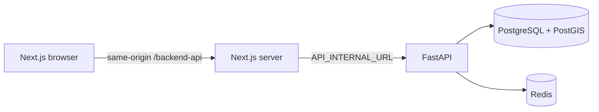

# Nearline — Nearby Services Platform

Public map for hospitals, ATMs, shops, and other places, with a JWT-protected admin panel. The API is FastAPI on PostgreSQL/PostGIS. Redis caches read endpoints and rate-limits clients. The UI is Next.js (App Router).

## Architecture



Requests move through three layers:

- **Routes** validate input, apply rate limits, and shape HTTP responses.
- **Services** own login, cache policy, and bulk import rules.
- **Repositories** own SQL, including the spatial queries.

Service locations are stored as `geography(Point, 4326)`. A GiST index (`ix_services_location`) supports radius and bounding-box lookups. Distance uses `ST_Distance` on geography, so the unit is metres. `ST_DWithin` keeps the radius filter index-friendly. Results are ordered nearest first.

Cache keys include a version counter (`cache:services:version`). Creates, updates, deletes, and bulk imports bump that counter only after the database commit succeeds, so a failed write does not leave readers on a new empty version. Keys also round coordinates (about 11 m for nearby search, about 110 m for map bounds) so identical searches share an entry. TTLs are short. If Redis is down, reads skip the cache and still hit PostGIS.

Rate limits are fixed windows in Redis, keyed by client IP:

| Scope | Default | Failure mode |
| --- | --- | --- |
| Public reads | 60 / minute | Fail open, so a Redis outage does not take the map down |
| Nearby and map search | 30 / minute | Fail open |
| Admin login | 5 / minute per IP and per email | Fail closed |

Successful responses include `X-RateLimit-Limit`, `X-RateLimit-Remaining`, and `X-Cache` (`HIT`, `MISS`, or `BYPASS`). A 429 includes `Retry-After`.

Admin auth is JWT. Access tokens are short-lived. Refresh tokens are stored in Redis and rotated on use. Logout revokes the access token until it expires and deletes the refresh token. Passwords are bcrypt hashes. Login returns the same error for an unknown email and a wrong password.

Sync SQLAlchemy with psycopg2 is intentional. GeoAlchemy2’s geometry adaptation is reliable on that driver, and FastAPI runs the sync endpoints in a threadpool.

## Run with Docker

Docker is the supported setup. From the repository root:

```bash
docker compose up --build
```

- App: http://localhost:3000
- API docs: http://localhost:8000/docs
- Health: http://localhost:8000/health

Admin login (change these before any shared deployment):

- Email: `admin@nearby.local`
- Password: `ChangeMe123!`

The first backend start runs migrations and loads `backend/data/sample_services.json` (36 places around Bengaluru) when the services table is empty. `backend/data/sample_services.csv` is the same set for the bulk-upload screen.

Set `ENV=production` only with a new `SECRET_KEY` and `ADMIN_PASSWORD`. The app refuses to boot in production with the sample secret or the sample password.

## Local development

Start PostGIS and Redis (the compose file can run just those two), then:

```bash
cd backend
python -m venv .venv
.venv\Scripts\activate
pip install -r requirements.txt
copy .env.example .env
alembic upgrade head
python -m app.db.seed
uvicorn app.main:app --reload --port 8000
```

```bash
cd frontend
copy .env.example .env.local
npm install
npm run dev
```

The browser calls `/backend-api/...`. The Next.js server proxies that to `API_INTERNAL_URL` (default `http://127.0.0.1:8000`). In Docker Compose that variable is `http://backend:8000`, so the API host is not baked into the frontend build.

## API Documentation

- **Swagger UI**: [http://localhost:8000/docs](http://localhost:8000/docs) (Interactive)
- **ReDoc UI**: [http://localhost:8000/redoc](http://localhost:8000/redoc)
- **OpenAPI JSON Spec**: `openapi.json` (at project root, or live at [http://localhost:8000/openapi.json](http://localhost:8000/openapi.json))
- **Postman Collection**: `postman_collection.json` (at project root, ready to import directly into Postman with pre-configured requests, environment variables, and auto token capture)

Public (no token):

- `GET /api/v1/services` — paginated directory, optional `category` and `q`
- `GET /api/v1/services/map` — places inside a bounding box
- `GET /api/v1/services/nearby` — `latitude`, `longitude`, `radius_km`; sorted by distance; includes `distance_km`
- `GET /api/v1/services/{id}` — optional origin for distance
- `GET /api/v1/services/categories`

Admin (`Authorization: Bearer <access_token>`):

- `POST /api/v1/auth/login`
- `POST /api/v1/auth/refresh`
- `POST /api/v1/auth/logout`
- `GET /api/v1/auth/me`
- `GET /api/v1/admin/stats`
- `POST /api/v1/admin/services`
- `PUT /api/v1/admin/services/{id}`
- `DELETE /api/v1/admin/services/{id}`
- `POST /api/v1/admin/services/bulk` — CSV or JSON, max 1,000 rows and 2 MB

Categories are `hospital`, `atm`, `shop`, and `other`. Rating is optional, from 0 to 5. Extra details (address, phone, description) live in the `metadata` object.

Errors use one shape:

```json
{"error": {"code": "NOT_FOUND", "message": "Service not found"}}
```

## Frontend

- `/` map, category filter, and nearby search
- `/directory` paginated directory
- `/services/[id]` details and a locator map
- `/admin/login`, `/admin`, `/admin/services`, `/admin/services/new`, `/admin/upload`

React Query holds server data. Zustand holds the admin session. The map is Leaflet with OpenStreetMap tiles. Map browsing loads the current viewport instead of the full table. The directory and admin table page through the list endpoint.

The access token is stored in `localStorage` because the assignment asks for bearer JWTs. A deployment that must contain XSS risk more tightly should move tokens into httpOnly cookies.

## Tests

Unit tests do not need a database:

```bash
cd backend
pytest tests/test_units.py -q
```

Integration tests need PostGIS and Redis. They refuse to run when `ENV=production`, and they delete only services whose names start with `IT `.

```bash
cd backend
set ENV=test
pytest tests/integration -q
```

GitHub Actions runs the unit tests, the PostGIS integration tests, and the Next.js build.

## Configuration

See `backend/.env.example`.

| Variable | Role |
| --- | --- |
| `DATABASE_URL` | `postgresql+psycopg2://...` |
| `REDIS_URL` | Cache, rate limits, refresh tokens |
| `SECRET_KEY` | JWT signing key |
| `CORS_ORIGINS` | Browser origins allowed to call the API directly |
| `TRUST_PROXY_HEADERS` | Use `X-Forwarded-For` only behind a proxy you control |
| `RATE_LIMIT_*` | Per-minute caps |
| `CACHE_TTL_*` | Seconds |
| `SEED_SAMPLE_DATA` | Load the sample file when the table is empty |
| `API_INTERNAL_URL` | Frontend server proxy target |
